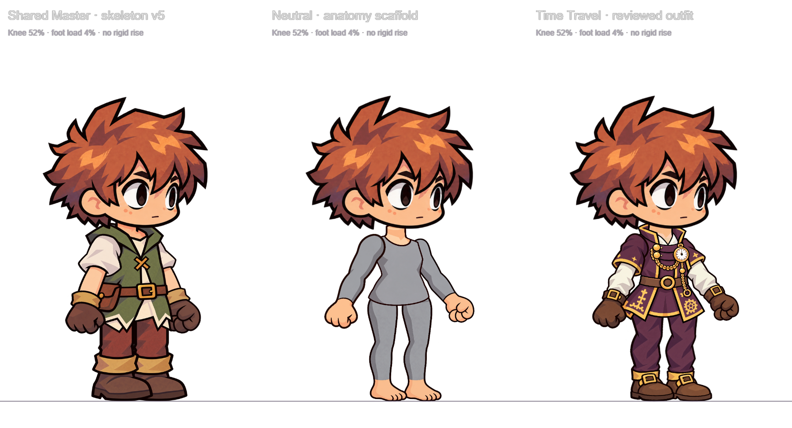
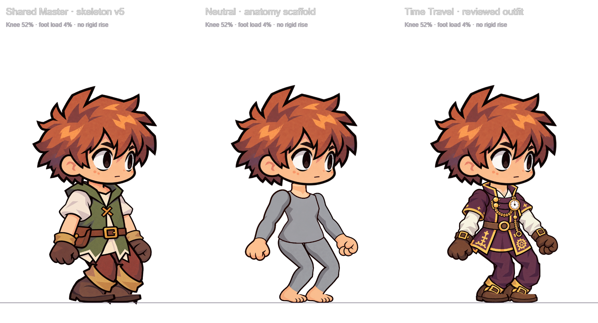

# Checkpoint verification

Delivery review: 2026-10-23 (Asia/Bangkok). This records evidence, not a production approval.

## Clean-checkout reproduction

Passed on Windows with Node 24.15.0, using a `git archive` of checkpoint `4ca1cc9` extracted
into a new empty directory. Dependencies were freshly installed there with
`npm ci --offline --ignore-scripts --no-audit --no-fund`; no original ignored drafts were copied.
`npm test` (9 tests), `npm run test:pipeline` (3 tests), `npm run build` and
`npm run export:runtime` all passed. The export contained 3 resolved rigs and 15 runtime textures.
The three material recipes also ran from this extracted tree, and all nine final part images
matched the published runtime pixels exactly.

GitHub Actions runs the same tests/build/export on Ubuntu for future pushes/PRs. Its definition
is included; this local verification is not a claim that a hosted CI run has already passed.

The follow-up [main-file audit](repository-audit.md) also passed `npm test`, the 3 Python tests,
TypeScript with `--noUnusedLocals --noUnusedParameters`, build and runtime export after moving
the legacy reference diagrams. All four moved PNGs retain identical Git blob hashes. Runtime
rig data and approved art were unchanged by that follow-up.

## Automated gates

- `npm test`: repository/spec/texture hashes and doc links, plus 9 Node tests covering core,
  editor and shared animation persistence/conflicts.
- `npm run test:pipeline`: 3 Python tests for material/alpha isolation and frozen builder anchors.
- `npm run typecheck` and `npm run build`: editor and maintained QA compile together.
- `npm run export:runtime`: standalone resolved rigs, core source, textures and handoff docs.
- All three material recipes were rebuilt from committed inputs; all nine final part images
  matched the selected runtime outputs pixel-for-pixel. Colour matching preserves alpha;
  this is not an alpha-fringe cleanup pass.

## Real renderer evidence

The maintained `/qa/` page renders the actual Pixi meshes, not infographic illustrations.
Select setup, shared idle, arm bend, knee bend, planted crouch, airborne foot or torso bend.
The screenshots below record setup and planted crouch with bones hidden for art inspection.

Observed limitation: the legacy Shared Master boot cuffs shear in a deep crouch. Its old
costume is retained for compatibility, not certified as newly reviewed production art.
Neutral and Time Travel are selected experiment assemblies, not a finished game animation set.

There has been no Phaser/gameplay, mobile GPU, atlas, slopes or moving-platform validation.
Automated tests check numeric/runtime contracts, not artistic acceptance of every pose.
